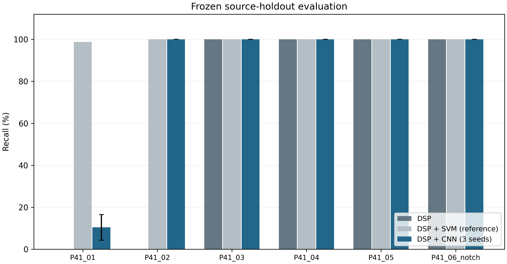
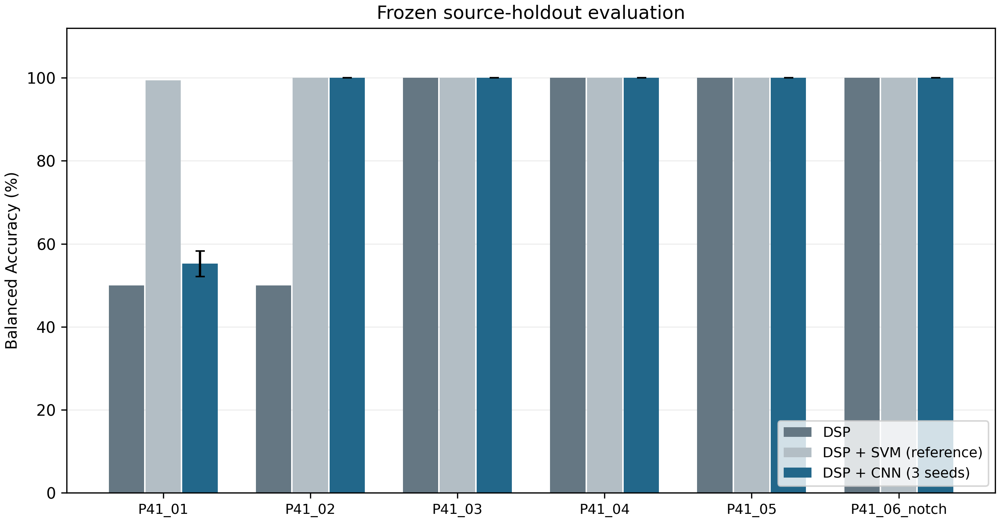
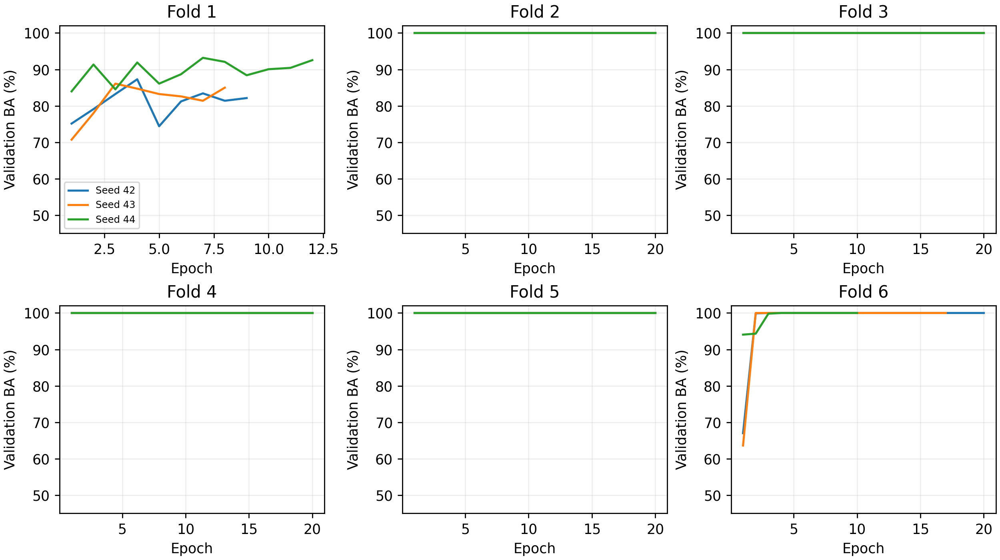

# Does a CNN Improve DSP Based Ultrasonic Flaw Detection on Unseen Sources

ELEC5305 Final Research Report | Karthik Ramesh | SID 550754365

GitHub code and reproducibility: https://github.com/karthikramesh7512-cmd/elec5305-project-550754365

Demonstration video: https://github.com/karthikramesh7512-cmd/elec5305-project-550754365/blob/main/docs/video/project_demo.mp4

## Abstract

This study asks whether a compact convolutional classifier applied after a fixed ultrasonic DSP front end improves detection of previously unseen experimental flaw sources relative to a validation-thresholded DSP detector. Seven thousand experimental B-scans are evaluated with six frozen source-holdout folds; the ordinary image-level split is a reference. DSP cropping, per-A-scan DC removal and Hilbert-envelope extraction are shared, while the CNN learns from compressed envelope maps. Three fixed training seeds are evaluated without test-driven model selection. Across the six held-out sources, CNN macro recall is 85.07% (seed SD 1.02 percentage points), compared with 66.67% for DSP and 99.79% for the SVM. CNN macro balanced accuracy is 92.54% (seed SD 0.51 points), versus 83.33% for DSP and 99.89% for the SVM. The repeated no-flaw background and augmented positive images restrict the scope of these findings. The contribution is a controlled, reproducible comparison of deterministic thresholding, engineered-feature SVM and a small convolutional decision rule, not a claim of general industrial reliability.

## Contents

1. Introduction and research question
2. Literature review and conceptual background
3. Methods
4. Results
5. Discussion
6. Conclusion
7. Reproducibility and references

## 1 Introduction and research question

Ultrasonic inspection identifies internal reflectors through the amplitude and spatial structure of returned signals. A practical automated detector must recognize flaw responses beyond the particular sources used for development. High accuracy on randomly partitioned augmented images may coexist with poor transfer to an unseen source. This makes the evaluation protocol part of the research question rather than a final reporting detail.

The single research question is: **Does replacing the final deterministic DSP decision rule with a compact CNN improve ultrasonic flaw detection on previously unseen P41 source labels, using the same experimental data and frozen evaluation folds?** The SVM is an additional learned reference that helps distinguish an advantage over a simple threshold from an advantage specific to convolutional feature learning.

The first project stage established the dataset audit and DSP/SVM baselines. The final extension adds a compressed-envelope CNN, repeated-seed evaluation, saved inference demonstration and direct comparison. The scope is binary detection. Localisation, equivalent crack sizing, noise robustness and simulated-to-real transfer are not claimed as completed outcomes.

## 2 Literature review and conceptual background

### 2.1 Representative ultrasonic training data

Virkkunen et al. [1] investigate convolutional detection with virtual-flaw augmentation to address scarce representative ultrasonic examples. Their work motivates learning spatial signal patterns rather than relying only on amplitude thresholds. Augmentation expands the available images, but it does not automatically supply independent physical flaws. For the present project, this distinction motivates auditing raw-image identity and treating ordinary image-level results as a reference. This experiment does not reproduce their network, human-inspector comparison or acquisition conditions; its small CNN is an intentionally simpler implementation.

Koskinen et al. [2] examine how flaw type and training flaw size affect CNN generalisation. Their findings motivate source-based exclusion: a model may learn characteristics of its training indications and transfer differently to other reflectors. This project therefore holds out P41 labels and examines source-wise recall instead of reporting only pooled accuracy. The dataset's original flaw-size values remain metadata for analysis, not model inputs. The published work establishes a relevant question, not a directly comparable numerical benchmark for the present folds.

### 2.2 Learned decision rules and representation choice

Cortes and Vapnik [3] establish support-vector classification through a margin-based decision surface and nonlinear feature mappings. The existing SVM is a useful low-capacity reference because it uses a small, interpretable DSP feature set. Its strength is computational simplicity; its limitation is dependence on the chosen features. It cannot discover spatial features that were discarded during extraction.

LeCun et al. [4] demonstrate convolutional learning for structured image recognition. Local connectivity and shared filters motivate the present CNN's use of envelope maps. Translation-tolerant pooling can reduce sensitivity to indication location, but also discards information. This general architectural motivation is not evidence that a CNN will outperform an SVM on a small ultrasonic dataset.

These publications support established approaches relevant to this question. They are not an exhaustive survey or a claim that the compact model represents the newest state of the art. The local contribution is to compare a deliberately small convolutional extension against frozen baselines under an explicit source-exclusion protocol.

### 2.3 Concepts needed to interpret the experiment

The analytic signal combines an RF trace with its Hilbert transform; its magnitude gives an envelope that reduces dependence on the carrier phase. A CNN applies learned spatial filters, followed here by nonlinear activations and pooling. Binary cross entropy trains a logit, and the sigmoid maps that logit to a score between zero and one. That score is not assumed to be calibrated probability under source shift.

Recall is TP/(TP+FN), specificity is TN/(TN+FP), and balanced accuracy is their arithmetic mean. ROC-AUC describes ranking across thresholds; it does not guarantee good recall at a selected operating point. This distinction is essential because the saved DSP detector ranks each held-out source perfectly while missing both smaller sources at its validation-derived thresholds.

## 3 Methods

### 3.1 Data and integrity audit

The study uses NDT_ML_Flaw experimental batches 013-019: 7,000 rows, including 3,442 positive and 3,558 negative rows. Raw images decode as little-endian int16 arrays of shape 480 by 7168. There are six recorded positive source labels. The 3,442 positive rows contain 1,880 distinct raw-image hashes; no identical positive hash spans multiple source labels. All negative rows contain one repeated image. These counts describe data identity, not proof of independence between distinct augmented images.

Each raw sample used for the CNN is checked against its original saved SHA-256 image hash. The 105 protected data/results files are checked before and after the new experiment. The baseline detector, saved SVMs, split manifests, labels and previous numerical results are neither regenerated nor altered.

### 3.2 Frozen evaluation design

The primary protocol contains six source-holdout folds. In each fold one source is tested, the next source cyclically is used for validation, and the remaining four sources train the model. Fixed negative groups of 593 rows rotate through the same roles. They are row groups, not independent negative acquisitions. A separate ordinary split uses 4,900 training, 1,050 validation and 1,050 test rows. It is reported only as an easier reference condition.

All methods are compared on exactly the same test sample IDs for each evaluation. CNN weights and normalization are fitted on training data only. Validation balanced accuracy chooses checkpoints, with lower validation loss breaking ties and the earliest epoch retained on an exact tie. All 21 selected checkpoints are saved and hashed before any CNN test evaluation. No test outcome changes the architecture, seed list, threshold or training budget.

### 3.3 Deterministic DSP and SVM references

The frozen DSP detector crops columns 1100:3100, removes each A-scan mean and computes the Hilbert envelope. It takes the maximum envelope response along each A-scan and smooths that spatial profile with candidate windows 1, 3, 5 and 7. Validation balanced accuracy selects a window and threshold; ties choose the highest optimal threshold and then the smallest window. Window 1 was selected in every saved evaluation. The final decision is score greater than or equal to threshold.

The saved SVM uses 12 engineered features including envelope amplitude statistics, RF RMS/energy, envelope energy, crest factor, peak counts, persistence, response width and spatial peak statistics. A training-only StandardScaler precedes the SVM. The original linear/RBF grid and validation selection are reused as historical evidence, without refitting. Comparing the CNN to this stronger reference guards against attributing every improvement over thresholding to deep learning.

### 3.4 DSP plus CNN pipeline

The CNN shares the same crop, DC removal and Hilbert magnitude. Non-overlapping 8 by 16 block maxima compress the 480 by 2000 envelope to 60 by 125. Fixed log1p compression reduces its dynamic range. Maximum pooling retains local peaks efficiently, but can suppress fine morphology. A scalar mean and standard deviation are estimated from training maps separately in each fold; no validation or test inputs contribute to these fitted values. Source, size, location, depth and labels are excluded from the network input.

Three padded 3 by 3 convolutions use 8, 16 and 32 output channels, each with ReLU. The first two convolutions are followed by 2 by 2 maximum pooling. Global spatial means and maxima are concatenated and mapped to one logit. There are 5,953 trainable parameters. This is a learned detector on compressed DSP outputs, not an end-to-end RF model or a reproduction of the published ultrasonic networks.

Adam uses learning rate 0.001, weight decay 0.0001 and batch size 64 with unweighted binary cross entropy. The fixed budget is 20 epochs and patience is five epochs without improvement under the checkpoint ordering. Seeds 42, 43 and 44 are all reported; the best test seed is not selected. No additional augmentation or pretrained weights are used. The decision threshold is fixed at 0.5 sigmoid score. Training uses PyTorch 2.9.0+cu126 and an NVIDIA RTX 3060 Laptop GPU with deterministic algorithms enabled.

### 3.5 Intended coverage and verification

The intended comparison measures source-wise detection, ordinary-split reference performance, training variability and computational burden. Every seed reports confusion counts, accuracy, recall, precision, F1, specificity, balanced accuracy and ROC-AUC. Macro averages weight each held-out source equally; seed standard deviations describe training variation, not uncertainty across independent specimens. Per-sample outputs and full-precision tables accompany rounded report values.

Independent saved-result checks verify test coverage, labels, decisions, ROC-AUC, confusion counts, training/validation membership, checkpoint selection and baseline preservation. The short demonstration loads saved weights and fixed examples without retraining. Generalisation to new backgrounds would require additional independent acquisitions. The original proposal's FMC/TFM, simulated transfer and controlled-noise extensions remain uncompleted, rather than being implied by this detection experiment.

## 4 Results

### 4.1 Primary source-holdout comparison

| Source | Size mm | DSP recall % | SVM recall % | CNN recall % | CNN BA % | CNN AUC |
|---|---|---|---|---|---|---|
| P41_01 | 2 | 0.00 | 98.72 | 10.42 +/- 6.14 | 55.21 +/- 3.07 | 1.0000 |
| P41_02 | 3 | 0.00 | 100.00 | 100.00 +/- 0.00 | 100.00 +/- 0.00 | 1.0000 |
| P41_03 | 26 | 100.00 | 100.00 | 100.00 +/- 0.00 | 100.00 +/- 0.00 | 1.0000 |
| P41_04 | 6 | 100.00 | 100.00 | 100.00 +/- 0.00 | 100.00 +/- 0.00 | 1.0000 |
| P41_05 | 17 | 100.00 | 100.00 | 100.00 +/- 0.00 | 100.00 +/- 0.00 | 1.0000 |
| P41_06_notch | 6 notch | 100.00 | 100.00 | 100.00 +/- 0.00 | 100.00 +/- 0.00 | 1.0000 |

CNN values are mean +/- sample standard deviation across three seeds. DSP and SVM values are the preserved single-fit results. BA denotes balanced accuracy. AUC is the mean CNN ROC-AUC across seeds.

Across the six held-out sources, CNN macro recall is 85.07% (seed SD 1.02 percentage points), compared with 66.67% for DSP and 99.79% for the SVM. CNN macro balanced accuracy is 92.54% (seed SD 0.51 points), versus 83.33% for DSP and 99.89% for the SVM. For P41_01, CNN recall is 10.42% +/- 6.14 percentage points across seeds. For P41_02, CNN recall is 100.00% +/- 0.00 percentage points across seeds. Source-specific results must be inspected alongside these macro averages because a strong aggregate can conceal poor recall on the smallest source.

### 4.2 Confusion counts and ordinary reference

Across source-holdout folds, each seed evaluates all 7,000 rows once. The pooled confusion counts below weight rows rather than sources, so they answer a different aggregation question from macro recall.

| Seed | TP | TN | FP | FN |
|---|---|---|---|---|
| 42 | 2955 | 3558 | 0 | 487 |
| 43 | 2917 | 3558 | 0 | 525 |
| 44 | 2984 | 3558 | 0 | 458 |

The ordinary split gives the following CNN reference results. Both saved DSP and SVM ordinary tests achieved 100% accuracy and recall. Near-ceiling ordinary performance should not be substituted for the held-out-source comparison.

| Seed | Accuracy % | Recall % | Balanced accuracy % | ROC-AUC |
|---|---|---|---|---|
| 42 | 100.00 | 100.00 | 100.00 | 1.0000 |
| 43 | 100.00 | 100.00 | 100.00 | 1.0000 |
| 44 | 100.00 | 100.00 | 100.00 | 1.0000 |

### 4.3 Training behaviour and computational burden

Selected epochs range from 3 to 20. Recorded training time totals 2.66 minutes across 21 fits, with median 8.35 seconds per fit on the stated GPU. This excludes decompression, preprocessing, cache generation and test inference. The parameter count is small, but CNN training and map generation introduce costs absent from the frozen threshold detector. No matched end-to-end timing benchmark was conducted, so these numbers do not establish deployment throughput or fair latency ratios against DSP/SVM.

## 5 Discussion

### 5.1 Answering the research question

The CNN improves macro recall by 18.40 percentage points over the frozen DSP detector, but is 14.72 points below the SVM. On the 2 mm source, seeds 42, 43 and 44 detect only 60, 22 and 89 of 547 positive rows, respectively; the SVM detects 540. All CNN source-holdout ROC-AUC values are 1.0 despite this weak 2 mm recall. Thus a learned ranking can still transfer better than its fixed operating point, just as with the DSP score. The CNN is not the best-performing method here, and the result does not justify replacing the SVM. No threshold is adjusted after observing this result.

The comparison tests a specific operating pipeline: shared DSP preprocessing followed by either a frozen amplitude decision rule or a small convolutional classifier. Improvement should therefore be interpreted relative to that detector, not as proof that convolution is universally superior to DSP. The SVM reference is important because it already resolves much of the threshold-transfer failure using a compact engineered representation. The tables identify whether the CNN adds anything beyond that reference.

The saved DSP ROC-AUC remains 1.0 in every evaluation despite zero recall for the two smallest held-out sources. Its validation threshold is effectively constrained by the validation source's amplitude range; a smaller test-source response can remain above all negatives but below that threshold. This is a calibration/operating-point failure rather than loss of ranking. A learned rule can exploit additional spatial or amplitude relationships, but a CNN's fixed 0.5 score threshold can also fail under source shift. The experiment does not identify a causal explanation for every error without an additional ablation.

### 5.2 Relationship to published work

The emphasis on source composition is consistent with Koskinen et al.'s concern that training flaw characteristics affect generalisation [2]. This study extends that concern to a controlled comparison with deterministic DSP and an engineered-feature model. It does not contradict or reproduce published probability-of-detection or human-level results: acquisition conditions, network architectures and evaluation definitions differ. No industrial POD qualification follows from row-level recall in this dataset.

### 5.3 What the comparison does and does not isolate

Keeping the raw samples, ROI and fold manifests fixed reduces obvious confounding from different datasets or easier test partitions. However, the CNN also changes representation through block pooling and log compression. A performance difference cannot be assigned solely to convolutional architecture, since these representation choices are not ablated. Useful follow-up comparisons would include an MLP on the same maps, a CNN without compression, and validation-selected CNN thresholds. Such experiments should be designed on fresh development data rather than adapted after observing these test results.

Three seeds make initialization sensitivity visible but are not independent physical experiments. Reporting all seeds avoids choosing a favourable test run; it does not establish a confidence interval for future flaws. Likewise, the six source labels are a limited and related set. Mean performance across them is descriptive and should not be assigned a broad population interpretation or an unsupported significance claim.

### 5.4 Principal limitations and how to resolve them

The repeated negative background is the strongest limitation. A model can recognize that background consistently while remaining untested on different couplings, materials, clutter or instruments. Consequently, specificity and false-positive counts must be read as performance on one repeated background. Resolving this requires independently acquired negative specimens and acquisition-group splits.

Distinct positive hashes do not eliminate augmentation dependence. Grouping by source label reduces direct source reuse across positive partitions, but cannot establish new-specimen independence. More original cracks and acquisition metadata would permit a stronger specimen-level evaluation. In particular, a binomial confidence interval treating every augmented row as independent would overstate precision and is not reported.

The map representation trades resolution for tractability. Narrow echoes can be retained by maximum pooling while subtle spatial texture is lost; global pooling also removes explicit location. Neither depth nor scan-axis localisation is evaluated. The work therefore supports a bounded binary-detection conclusion, not the full localisation ambitions in the original proposal. Controlled noise robustness, independent-background evaluation and a preplanned representation ablation are the most informative next tests.

## 6 Conclusion

Across the six held-out sources, CNN macro recall is 85.07% (seed SD 1.02 percentage points), compared with 66.67% for DSP and 99.79% for the SVM. CNN macro balanced accuracy is 92.54% (seed SD 0.51 points), versus 83.33% for DSP and 99.89% for the SVM. DSP plus CNN improves the frozen DSP operating rule primarily by recovering the 3 mm source, while 2 mm recall remains poor. It does not outperform the SVM. All three methods retain perfect source-wise ranking in this experiment, which makes operating-point transfer a central issue rather than evidence of universal CNN superiority. The saved SVM provides a strong alternative learned decision boundary and prevents a claim that extra model complexity is automatically beneficial. The research question is answered for these six held-out source labels and the fixed representation; new-specimen generalisation and realistic false-positive control remain open.

## 7 Reproducibility and references

The repository includes working inference code, fixed demonstration inputs, all selected weights, split manifests, per-sample predictions, training curves and numerical verification. Run `python src/demo_cnn.py` for the portable demonstration and `python src/verify_cnn_results.py` to check the saved experiment without fitting a model. `requirements-cnn.txt` records the final-stage environment. Raw data and the large local cache are excluded; the original upstream dataset is linked in the README. Full training instructions and the fixed protocol are documented separately. The report and video are linked from the repository.

AI assistance: OpenAI Codex assisted with implementation, experiment orchestration, verification and report preparation. The cited publications and upstream dataset are credited below; the author retains responsibility for the submitted analysis.

[1] I. Virkkunen, T. Koskinen, O. Jessen-Juhler and J. Rinta-aho, "Augmented Ultrasonic Data for Machine Learning," Journal of Nondestructive Evaluation, vol. 40, art. 4, 2021. https://doi.org/10.1007/s10921-020-00739-5

[2] T. Koskinen, I. Virkkunen, O. Siljama and O. Jessen-Juhler, "The Effect of Different Flaw Data to Machine Learning Powered Ultrasonic Inspection," Journal of Nondestructive Evaluation, vol. 40, art. 24, 2021. https://doi.org/10.1007/s10921-021-00757-x

[3] C. Cortes and V. Vapnik, "Support-vector networks," Machine Learning, vol. 20, pp. 273-297, 1995. https://doi.org/10.1007/BF00994018

[4] Y. LeCun, L. Bottou, Y. Bengio and P. Haffner, "Gradient-based learning applied to document recognition," Proceedings of the IEEE, vol. 86, no. 11, pp. 2278-2324, 1998. https://doi.org/10.1109/5.726791
